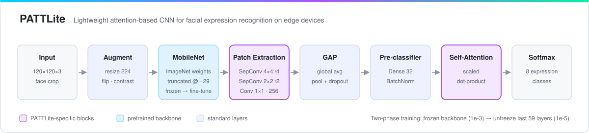

<div align="center">

# PATTLite

**Lightweight attention-based CNN for facial expression recognition on edge devices**

Official implementation of *“Enhancing facial expression recognition with lightweight attention-based CNN”*,<br/>
Journal of Ambient Intelligence and Humanized Computing (Springer), 2026.

[](https://doi.org/10.1007/s12652-026-05116-0)
[](https://doi.org/10.1007/s12652-026-05116-0)
[](LICENSE)


[Quick start](#-quick-start) · [Training](#-training) · [Evaluation](#-evaluation--inference) · [Citation](#-citation)

</div>

<picture>
  <source media="(prefers-color-scheme: dark)" srcset="assets/architecture-dark.svg">
  
</picture>

## ✨ Highlights

- **Edge-friendly** — a *truncated* ImageNet MobileNet backbone keeps the parameter count and latency low enough for devices with limited compute.
- **Patch Extraction block** — separable convolutions split the feature map into non-overlapping regions, so the model attends to local facial parts and stays robust to **occlusion and head-pose variation**.
- **Self-attention classifier** — scaled dot-product attention over the pooled features sharpens the discrimination between similar expressions.
- **Two-phase training** — train the head on a frozen backbone (lr 1e-3), then unfreeze the last 59 backbone layers and fine-tune end-to-end (lr 1e-5).
- Evaluated on **RAF-DB, FER2013, FERPlus** and a custom in-the-wild set with occlusion and pose changes — see the [paper](https://doi.org/10.1007/s12652-026-05116-0) for the full results.

## 🚀 Quick start

```bash
git clone https://github.com/VuVietAnh2309/pattlite-fer.git
cd pattlite-fer
python -m venv .venv && source .venv/bin/activate   # Windows: .venv\Scripts\activate
pip install -r requirements.txt
python model.py          # builds PATTLite and prints the model summary
```

## 📁 Dataset

The default configuration targets **RAF-DB**. Arrange the images one folder per class:

```
dataset/
├── train/{1..7}/
└── test/{1..7}/
```

Then point `DATA_CONFIG` in [`config.py`](config.py) at it (`dataset_path`, `dataset_name`) and set `num_classes` to match your dataset (7 for RAF-DB, 8 for FERPlus).

## 🏋️ Training

```bash
# Phase 1 — frozen backbone, train the head
python train.py --epochs 100 --batch-size 8 --model-path checkpoints/model_initial.h5

# Phase 2 — unfreeze the last 59 backbone layers and fine-tune
python finetune.py --pretrained-model checkpoints/model_initial.h5 \
                   --model-path checkpoints/model_finetune.h5 --epochs 65 --batch-size 8
```

All hyperparameters (image size, patch filters, dropout, learning rates, layers to unfreeze) live in [`config.py`](config.py).

## 📊 Evaluation & inference

```bash
# Accuracy / precision / recall / F1, per-class accuracy, confusion matrix, classification report
python evaluate.py --model-path checkpoints/model_finetune.h5 --split test --save-predictions

# Single image (with visualisation) or a whole folder
python predict.py --image path/to/face.jpg --visualize --output results/prediction.png
python predict.py --image-folder path/to/images/
```

## 🗂️ Repository structure

```
pattlite-fer/
├── config.py          # all hyperparameters and paths
├── dataset.py         # data loading & preprocessing
├── model.py           # PATTLite architecture
├── train.py           # phase 1 — frozen-backbone training
├── finetune.py        # phase 2 — fine-tuning
├── evaluate.py        # metrics, confusion matrix, reports
├── predict.py         # inference on images / folders
├── utils/             # callbacks, metrics, visualisation
├── docs/architecture.md
└── assets/            # figures used in this README
```

Each module can be run on its own as a smoke test (`python config.py`, `python dataset.py`, `python model.py`, `python utils/callbacks.py`).

<details>
<summary><b>🛠️ Troubleshooting</b></summary>

- **Out of memory** — lower `batch_size` in `config.py`.
- **Low accuracy** — train longer, tune the learning rate, enable class weights for imbalanced data, and check the preprocessing pipeline.
- **Slow training** — use a GPU, raise the batch size, or enable mixed precision.

</details>

## 📝 Citation

If this code helps your research, please cite the paper (GitHub's **“Cite this repository”** button on the right gives the same entry):

```bibtex
@article{vu2026pattlite,
  title   = {Enhancing facial expression recognition with lightweight attention-based CNN},
  author  = {Vu, Viet Anh and Pham, Gia Khanh and Tran, Quy Nam and Do, Son Tung and Pham, Danh Tuyen and Pham, Van Hai},
  journal = {Journal of Ambient Intelligence and Humanized Computing},
  publisher = {Springer},
  year    = {2026},
  doi     = {10.1007/s12652-026-05116-0}
}
```

## 📄 License

Code released under the [MIT License](LICENSE). The datasets (RAF-DB, FER2013, FERPlus) are **not** included and remain under their own licences.

## 📬 Contact

**Viet Anh Vu** — Hanoi University of Science and Technology (HUST)<br/>
[vietanhresearcher@gmail.com](mailto:vietanhresearcher@gmail.com) · [ORCID 0009-0006-6977-5922](https://orcid.org/0009-0006-6977-5922) · [vuvietanh2309.github.io](https://vuvietanh2309.github.io/)

Questions and bug reports are welcome via [GitHub Issues](https://github.com/VuVietAnh2309/pattlite-fer/issues).
